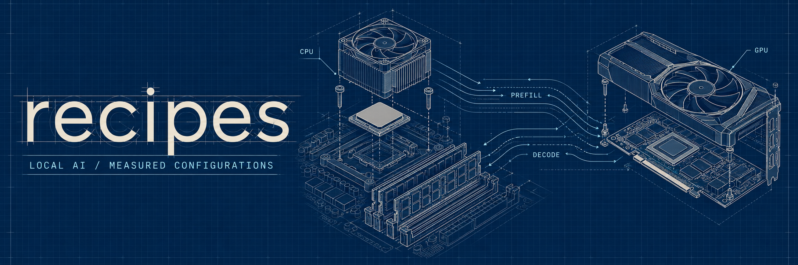
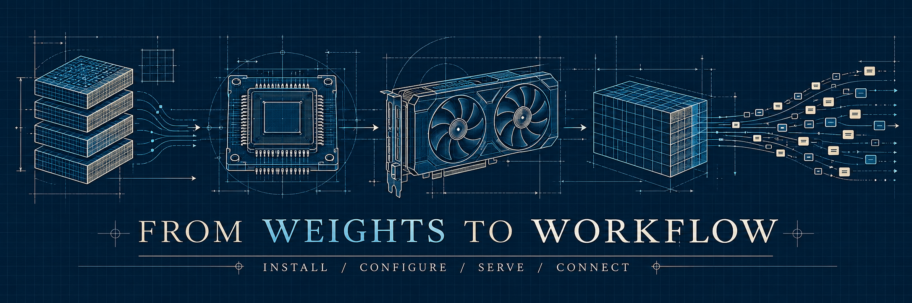

# recipes

[English](README.md) · [Español](README.es.md) · [简体中文](README.zh-CN.md)

我的本地推理配置，面向 **AMD Ryzen 5 5600X · RTX 3060 12 GiB · 32 GiB 内存**。包含模型权重来源、固定引擎版本、自动启动脚本、智能体客户端配置和实测性能。**仅文本，每次只运行一个生成请求。** 仓库在准备阶段保持私有。

清点及日志恢复日期：**2026-10-24**。Flint 测量于 10 月 22 日，Nemotron 于 23 日；Qwen/Gemma/GPT 的新测量于 24 日。这些是在本机已尝试配置中选出的方案，不代表已证明的全局最优值。

## 目录

- [模型与性能](#models)
- [硬件与适用范围](#hardware)
- [快速开始](#quick-start)
- [各模型配置](#recipes)
  - [Qwen 3.6](#qwen)
  - [Gemma 4](#gemma)
  - [GPT-OSS](#gpt-oss)
  - [Flint](#flint)
  - [Nemotron + DFlash](#nemotron)
- [OpenAI 兼容 API](#api)
- [OpenCode、Hermes、Codex 和 Claude Code](#clients)
- [FreeToken Desktop](#desktop)
- [日志与复现](#evidence)
- [仓库结构与许可证](#layout)

<a id="models"></a>
## 模型与性能

**上下文包括输入、历史消息、模板、推理和输出。** 速度单位为 tokens/s，容量单位为 tokens。输出列是默认预算，并不表示每个模型都已实测生成该长度。

| 模型 | 引擎 | 总上下文 | 输入预算¹ | 输出¹ | Drafter | Prefill | Decode | 实测负载 | 量化 | 来源 / 配置 |
|---|---|---|---|---|---|---|---|---|---|---|
| Qwen 3.6 35B A3B | FreeToken | 66560 | 58368 | 8192 | 无 | 2841.17² | 70.51² | 4106 + 200 × 3 | NVFP4 ModelOpt （混合） | [原模型](https://huggingface.co/Qwen/Qwen3.6-35B-A3B) · [权重](https://huggingface.co/nvidia/Qwen3.6-35B-A3B-NVFP4) · [配置](profiles/qwen3.6.json) |
| Gemma 4 26B A4B | FreeToken | 66560 | 58368 | 8192 | 无 | 1442.59² | 32.11² | 4109 + 200 × 3 | NVFP4 ModelOpt （混合） | [原模型](https://huggingface.co/google/gemma-4-26B-A4B-it) · [权重](https://huggingface.co/nvidia/Gemma-4-26B-A4B-NVFP4) · [配置](profiles/gemma4.json) |
| GPT-OSS 20B | FreeToken | 66560 | 58368 | 8192 | 无 | 2272.64² | 42.31² | 4163 + 200 × 3 | MXFP4 | [原模型](https://huggingface.co/openai/gpt-oss-20b) · [权重](https://huggingface.co/openai/gpt-oss-20b) · [配置](profiles/gpt-oss.json) |
| Flint 39.8B A2.5B | FreeToken | 73728 | 65536 | 8192 | 无 | 1543.59³ | 49.97³ | 65536 + 8192 | NVFP4 GGUF 官方 | [原模型](https://huggingface.co/RecursiveSI/flint) · [权重](https://huggingface.co/RecursiveSI/flint-nvfp4-gguf) · [配置](profiles/flint.json) |
| NVIDIA Nemotron 3.5 Bolt E4B | llama.cpp | 65536 | 57344 | 8192 | BF16 DFlash | 1964.10³ | 108.04³ | 277–411 + 1242–1762 | Unsloth UD-Q8_K_XL GGUF （混合） | [原模型](https://huggingface.co/nvidia/NVIDIA-Nemotron-3.5-Bolt-E4B-BF16) · [权重](https://huggingface.co/unsloth/NVIDIA-Nemotron-3.5-Bolt-E4B-GGUF) · [配置](profiles/nemotron.json) |

1. 本仓库为智能体使用预留 **8192 个输出 token**，推理同样消耗此预算。输入预算还包含系统指令、工具定义和对话模板。目前只有 Flint 保留了 65536 输入 + 8192 输出的完整测量。Nemotron 的 65536 是总容量，预留输出后输入预算为 57344。
2. Qwen/Gemma/GPT 使用**新采集的 HTTP 流式测量**，排除一次预热后取三次请求的算术平均。Prefill = prompt token 数 / 到首个非空文本**或推理**事件的时间。Decode =（输出 token 数 − 1）/ 首个至最后一个此类事件的间隔。包含本地服务开销，并假定 token 计数与流式分块相对应。三次请求使用不同的合成前缀；缓存计数见原始日志。主表以这些新数据替代不完整的历史日志。
3. Flint 使用历史 HTTP 方法，计时至首个**文本**事件。Nemotron 使用 llama.cpp 的请求级计时；其 prefill 仅统计未缓存 token，每次复用 38 个 token。**负载及计量方式不同，不能视为受控的引擎对比。** 在配置了 64K 容量的服务器上运行短提示词，不等同于实测 64K 活跃历史。

Gemma/GPT 的历史引擎日志数字仍保留在[证据文件](evidence)中：分别为 328.21 / 41.24 和 307.26 / 65.15。这些数字来自引擎周期性统计，不能与新的 HTTP 数值混用。

<a id="hardware"></a>
## 硬件与适用范围

Ryzen 5 5600X，6 核 / 12 线程，标称 32 GiB 内存，RTX 3060 12 GiB（SM86），NVIDIA 驱动 615.78.08。FreeToken 在 CPU/GPU 之间卸载专家；Nemotron 的主模型和 drafter 则全部放入 3060。[硬件](evidence/hardware.json) · [带宽微基准](evidence/bandwidth.json)。

本机还安装了 RTX 2070 8 GiB。之前的双 GPU 实验受到热降频影响（88°C / 300 MHz），因此未将其结果列为优化配置。启动器按 UUID 选择 3060，并将其暴露为设备 0。在 Ampere 上使用 NVFP4 权重存储，并不意味着使用 Blackwell 原生 FP4 指令。

<a id="quick-start"></a>
## 快速开始



要求：Linux x86_64、Python 3.12+、Git、兼容所选 CUDA 运行时的 NVIDIA 驱动，以及足够的磁盘和内存。FreeToken 还需要 [`uv`](https://docs.astral.sh/uv/getting-started/installation/)。FreeToken 使用固定的 CPython 3.12 wheel；未缓存的内核可能需要 CUDA 13 工具包。Nemotron 使用 llama.cpp b11828 的官方 CUDA 13.4 二进制及运行时压缩包，并验证 SHA-256。

```bash
gh repo clone jesusjodar/recipes
cd recipes
./recipes list

./recipes install
./recipes download gemma4
./recipes serve gemma4

# Nemotron 使用独立引擎，无需安装 FreeToken。
./recipes install --llama-cpp
./recipes download nemotron
./recipes serve nemotron
```

**每次只启动一个模型服务器**，等待 `LISTO` 后再连接客户端。先关闭其他模型服务器以释放显存。Ctrl+C 会清理启动器创建的进程。FreeToken 需要 API 端口及其下一端口；llama.cpp 只需要 API 端口。

```bash
./recipes serve gemma4 --port 22420
./recipes serve gemma4 --gpu GPU-YOUR-CARD-UUID
./recipes show gemma4
./recipes serve nemotron --print-command
```

默认权重目录为 `~/.freetoken/models`；可用 `RECIPES_MODEL_DIR` 指定其他目录。Nemotron 也会复用已存在且哈希正确的 `~/Desktop/AI/models` 文件，引擎压缩包可从 `~/Desktop/AI/bin` 复用。Qwen/Gemma/GPT 会复用完整的本地分片，但无法确认其历史权重版本；公布的固定版本用于**新下载**。Nemotron 的主模型和 drafters 已完整计算 SHA-256，并与 Hub blob 对照。[清单](evidence/inventory.json) · [固定运行时版本](runtime.json)。

<a id="recipes"></a>
## 各模型配置

<a id="qwen"></a>
### Qwen 3.6 35B A3B

总上下文 66560，3328 个专家缓存槽，4 个 GDN/Mamba 状态槽，hybrid fetch 1。先以 1024 个专家启动，再重建缓存。Desktop 保存的 `swaTokens=2048` 对此循环状态模型不起作用；**CLI 重建请求不发送 `num_swa_pages`**，否则引擎会拒绝。采样：temperature 1、top-p 0.95、top-k 20。

```bash
./recipes install
./recipes download qwen3.6
./recipes serve qwen3.6
```

新证据包含三次 4106 输入 + 200 输出请求、完整启动/重建日志和 SSE 事件。这些请求未验证接近满容量的活跃上下文，也未验证默认的 8192 输出。[配置](profiles/qwen3.6.json) · [测量](evidence/qwen3.6.json) · [客户端](clients/qwen3.6)。

<a id="gemma"></a>
### Gemma 4 26B A4B

**禁用视觉和音频。** 总上下文 66560，448 个专家，hybrid fetch 1。CLI 保留初始的 13312-token SWA 池，而 Desktop 保存的是 1024；两者缓存几何不同。新测试在 prefill 上限 8192 时出现 CUDA 显存不足，因此本配置将 prefill 分块改为 **1024**，并保留失败日志及调整后的成功测量。常规采样：temperature 1、top-p 0.95、top-k 64。

```bash
./recipes install
./recipes download gemma4
./recipes serve gemma4
```

旧的 1425 专家配置无法容纳更大的上下文。针对本 CLI 配置，新的短请求日志替代旧摘要；这不证明已在 66560-token 满容量下完成生成。[配置](profiles/gemma4.json) · [新测量和历史摘录](evidence/gemma4.json) · [客户端](clients/gemma4)。

<a id="gpt-oss"></a>
### GPT-OSS 20B

MXFP4 权重，总上下文 66560，256 个专家，hybrid fetch 1。此前 16K 上下文的 535 专家配置无法为更大上下文留出空间。CLI 的 SWA 池为 13312，Desktop 为 512。引擎使用 Harmony 协议及 checkpoint 默认采样设置；测量请求使用 temperature 0。

```bash
./recipes install
./recipes download gpt-oss
./recipes serve gpt-oss
```

[配置](profiles/gpt-oss.json) · [新测量和历史摘录](evidence/gpt-oss.json) · [客户端](clients/gpt-oss)。上下文预留容量与实际测量的短输入需分别理解。

<a id="flint"></a>
### Flint 39.8B A2.5B

官方 NVFP4 GGUF，固定版本 `6ec43e19…`。**65536 输入 + 8192 输出**。最终缓存 3456 个专家，SWA 5120，prefill 分块 4096，memory ratio 0.90，启用 CUDA normalization 和 prefill D2D 命中。先以 1024 个专家启动，加载后重建。

```bash
./recipes install --flint
./recipes download flint
./recipes serve flint
```

支持代码已在 [FreeToken #797](https://github.com/FlashML-org/FreeToken/pull/797) 提出。安装器固定到评审后的 Python 提交 `6ee048e…`，并复用 wheel 原生扩展；**性能数据来自更早的目录树 `edfba5e…`，尚未在安装器对应提交上重测**。这不是从源码完整编译 CUDA 的安装方式。

| 历史负载 | 有效 prefill | Decode | 首 token 时间 |
|---|---:|---:|---:|
| 8192 + 256，冷前缀，三次平均 | 2783.31 | 66.53 | ≈2.94 秒 |
| 65536 + 8192，冷前缀，一次 | 1543.59 | 49.97 | 42.46 秒 |
| 65536 + 256，复用前缀 | 复用 65535 tokens | 50.38 | 0.88 秒 |

仅吞吐基准强制使用 `ignore_eos`；日常服务正常遵循 EOS。另外完成过一次 >64K 的工具调用循环，但不能据此断言一般编程质量。观测峰值显存约 10.61 GiB，含桌面；主机专家约占 19.8 GiB。采样：temperature 1、top-p 0.95、top-k 20。[配置](profiles/flint.json) · [结果](evidence/flint.json) · [参数扫描日志](evidence/logs/flint) · [客户端](clients/flint)。

研究目录还保存了 [FutureMLS-Lab Flint ModelOpt 导出](https://huggingface.co/FutureMLS-Lab/flint-nvfp4-coldgptq)，版本 `56f37fcf…`，本地重新整理成按层存放的 safetensors。该版本用于一致性、AIME 和缓存重建验证，服务容量为 8192；没有优化过的长上下文吞吐或输出目标。因此只记录在清单中，不作为另一份已优化配方宣传。[验证日志](evidence/logs/flint-validation)。

<a id="nemotron"></a>
### NVIDIA Nemotron 3.5 Bolt E4B + DFlash

**llama.cpp b11828 CUDA 13.4**，Unsloth **UD-Q8_K_XL** 主模型，NVIDIA 官方 **BF16 GGUF DFlash** drafter，最多草拟 7 个 token（块大小 8）。两者完整加载到 GPU，启用 Flash Attention、Jinja，单槽位，关闭自动 fitting，**总上下文 65536**。不加载视觉 projector。temperature 1、top-p 0.95。本仓库新增 8192 的默认输出预算；历史请求自行指定输出限制。

```bash
./recipes install --llama-cpp
./recipes download nemotron
./recipes serve nemotron
```

在 64K 容量配置下，三项合成编程任务使用 277–411 个 prompt token，分别生成 **1242 / 1721 / 1762** 个 token，均正常结束。引擎平均 prefill **1964.10**、decode **108.04**，API 端到端输出速率 **106.86**，草拟接受率 **32.4%**。每次请求复用 38 个 prompt token，显存约 8.6 GiB。**尚未测量接近 64K 的活跃历史。** 生成补丁仅作为计时样本，不是经过正确性验证的解决方案。

此前四项 8K 容量测试各生成 256 个 token。官方 BF16 drafter 的平均速率为 **117.63 API / 121.63 引擎 decode**；下载的 Unsloth Q8_0 drafter 为 **85.34 / 87.52**。因此选用 BF16。以上不是原生 NVFP4 drafter 的结果，该实验不列为已测配方。新启动器使用与客户端一致的 **1919** 端口；原 Desktop/AI 服务使用 **8000**，这些命令不会修改该服务。

[配置](profiles/nemotron.json) · [证据](evidence/nemotron.json) · [原始 JSON 与脚本](evidence/logs/nemotron) · [客户端](clients/nemotron) · [主模型权重](https://huggingface.co/unsloth/NVIDIA-Nemotron-3.5-Bolt-E4B-GGUF) · [官方 drafter](https://huggingface.co/nvidia/NVIDIA-Nemotron-3.5-Bolt-E4B-4GB-DFlash)。

<a id="api"></a>
## OpenAI 兼容 API

所有启动器只绑定 `127.0.0.1`，不要求 API 密钥，也不公开暴露服务。模型 ID 为 `qwen3.6`、`gemma4`、`gpt-oss`、`flint`、`nemotron`。

```bash
curl --fail-with-body http://127.0.0.1:1919/v1/models
curl --fail-with-body http://127.0.0.1:1919/v1/chat/completions \
  -H 'Content-Type: application/json' \
  -d '{"model":"nemotron","messages":[{"role":"user","content":"请概述这个项目。"}],"max_tokens":8192,"stream":true}'
```

```python
from openai import OpenAI
client = OpenAI(base_url="http://127.0.0.1:1919/v1", api_key="local-no-key")
r = client.chat.completions.create(
    model="nemotron", max_tokens=8192,
    messages=[{"role": "user", "content": "请总结这个 diff。"}],
)
print(r.choices[0].message.content)
```

`local-no-key` 是供 SDK 使用的公开占位符。FreeToken 环境已含 OpenAI SDK；若只安装 llama.cpp，需另行安装，例如 `uv run --with openai your_script.py`。两种引擎都提供 `/v1/responses` 和 `/v1/messages`；固定版本的 llama.cpp 说明见[这里](https://github.com/ggml-org/llama.cpp/blob/b11828/tools/server/README.md)。本地适配器不代表完全支持 OpenAI/Anthropic 的所有功能。FreeToken Responses 是无状态子集：需要重发历史与工具，不能依赖存储的响应、`previous_response_id` 或后台任务；必要时保留推理字段。

<a id="clients"></a>
## 智能体客户端

先启动模型。以下示例使用 **Nemotron**；切换模型时应同步修改模型 ID、客户端目录和上下文。每个模型在 `clients/` 下都有自己的配置。这里提供配置示例和端点检查结果，**没有声称每个客户端都已完成真实的完整编程会话验证**。

| 客户端 | 协议 | 文件 |
|---|---|---|
| OpenCode v2.1.4 | Chat Completions | [v2 JSON](clients/nemotron/opencode-v2.json) |
| OpenCode v1 | Chat Completions，配置格式不同 | [v1 JSON](clients/nemotron/opencode-v1.json) |
| Hermes Agent | Custom provider，Chat Completions | [YAML](clients/nemotron/hermes.yaml) |
| Codex CLI 0.164.0 | Responses | [启动脚本](clients/nemotron/codex.sh) · [TOML](clients/nemotron/codex.toml) |
| Claude Code 2.1.310 | Anthropic Messages 适配器 | [启动脚本](clients/nemotron/claude-code.sh) |

### OpenCode

将对应 JSON 合并进工作项目的 `opencode.json`，保留现有设置。v2 使用 `providers/package/settings`，v1 使用 `provider/npm/options`。在 `/models` 中选择 `recipes/nemotron`，或执行：

```bash
opencode run --model recipes/nemotron "请概述项目结构"
```

配置声明文本、工具、推理字段、上下文/输入/输出预算及 `max_tokens=8192`。

### Hermes

按[官方指南](https://hermes-agent.nousresearch.com/docs/getting-started/installation)安装后，用 `hermes model` 选择 Custom endpoint，或执行：

```bash
hermes config set model.provider custom
hermes config set model.default nemotron
hermes config set model.base_url http://127.0.0.1:1919/v1
hermes config set model.api_mode chat_completions
hermes config set model.context_length 65536
hermes chat
```

不要加入已废弃的 `model.max_tokens`。服务器默认输出为 8192。上下文分别为：Nemotron 65536；Qwen/Gemma/GPT 66560；Flint 73728。

### Codex

```bash
bash clients/nemotron/codex.sh
```

脚本仅为当前进程覆盖 provider，不修改全局登录或配置。使用 Responses，不要求 OpenAI 身份验证，也不启用 WebSockets；在输入预算耗尽前进行压缩。TOML 包含相同选项，供手动集成。

### Claude Code

```bash
bash clients/nemotron/claude-code.sh
```

使用**不含 `/v1`** 的根 URL；客户端会追加 `/v1/messages`。所有模型别名均指向同一本地模型。Anthropic **未正式支持非 Claude 模型**；行为取决于模型和适配器的兼容性。此处固定的两种引擎无需额外的 Chat Completions→Messages 代理。脚本保留审批控制。[详细说明及官方来源（西班牙语）](docs/clients.md)。

<a id="desktop"></a>
## FreeToken Desktop

```bash
./recipes desktop gemma4
# 应用前先关闭 Desktop。
./recipes desktop gemma4 --apply
```

默认预览；`--apply` 会先备份，再合并该模型的缓存配置和仅文本标志。不会安装 Flint 支持或更改全局选项、引擎、Downloads 卡片。**Nemotron 的实测配置使用 llama.cpp，没有 FreeToken Desktop 配置。** [全局配置及 CLI/Desktop 差异](docs/desktop.md)。

<a id="evidence"></a>
## 日志与复现

- [日志清单](evidence/logs/manifest.json)：恢复来源、SHA-256 与脱敏说明。移除个人目录、工作区路径、GPU UUID 和终端颜色；不包含私人对话、凭据、声音数据或网络信息。
- [Qwen](evidence/logs/qwen3.6)、[Gemma](evidence/logs/gemma4)、[GPT-OSS](evidence/logs/gpt-oss)：新的完整服务器日志和逐请求 SSE 捕获，并保留可恢复的历史终端输出。Gemma 的 8192-prefill 失败记录也保留。
- [Nemotron](evidence/logs/nemotron)：原始 JSON 测量、脚本和报告。历史完整服务器 stdout 未保留，不能根据摘要忠实重建。
- [Flint](evidence/logs/flint)：原始扫描日志、JSON 与 GPU 采样；另有[验证日志](evidence/logs/flint-validation)。
- [方法与限制](docs/measurements.md) · [恢复审计](docs/log-recovery.md) · [运行时版本](runtime.json) · [关键依赖约束](constraints.txt)。

原 Gemma/GPT 临时日志已丢失。终端捕获明确标为恢复材料，可能保留当时的截断；新测量单独记录，不冒充历史原件。`null` 表示未知。模型权重不上传。

复现时，按记录的缓存几何运行单个模型，保存 stdout/stderr，再用 FreeToken 环境运行合成基准：

```bash
./recipes serve gemma4 > /tmp/gemma4-server.log 2>&1
# 另开终端，等待 LISTO 后执行：
.venv/bin/python scripts/benchmark-freetoken.py gemma4 \
  --output /tmp/gemma4-new-measurement.json
```

应记录引擎版本、硬件、权重哈希、实际 token 数、缓存状态、EOS 策略、预热和全部样本。新基准仅为固定长度测试启用 `ignore_eos`。在宣称满上下文性能前，必须实测接近上限的输入和输出。安装器保存本地 `uv pip freeze`，不提供完整的传递依赖锁；尚未验证全新 FreeToken 环境的完整引导安装。

<a id="layout"></a>
## 仓库结构与许可证

```text
profiles/        模型、引擎、启动参数、上下文和输出策略
clients/         各模型的 OpenCode、Hermes、Codex、Claude 配置
evidence/        测量、清单和脱敏日志
scripts/         安装、下载、服务、Desktop 合并和基准
assets/          两张 ImageGen 原创蓝图风格横幅
docs/            方法、恢复、Desktop、客户端及图片来源
runtime.json     固定版本、压缩包/wheel 哈希和 Flint 提交
```

新增配方需要配置文件、固定权重来源、实际测量负载/日志、客户端示例和表格条目。必须区分预留容量、已测负载和目标输出。辅助文档主要为西班牙语；三个 README 均包含完整使用概览。

[MIT](LICENSE) 适用于原创配置和脚本；引擎与模型遵循各自许可证。Nemotron 采用 **OpenMDW-1.1**，请查阅上游模型卡。[横幅提示词与来源](docs/artwork.md)：ImageGen 生成的原创蓝图风格图片，不是官方标志，也不构成性能认证。

来源：[FreeToken](https://github.com/FlashML-org/FreeToken) · [llama.cpp b11828](https://github.com/ggml-org/llama.cpp/releases/tag/b11828) · [OpenCode](https://opencode.ai/v2/docs/providers) · [Hermes](https://hermes-agent.nousresearch.com/docs/integrations/providers) · [OpenAI 配置](https://learn.chatgpt.com/docs/config-file/config-reference) · [Claude 网关](https://code.claude.com/docs/en/llm-gateway-connect)。
